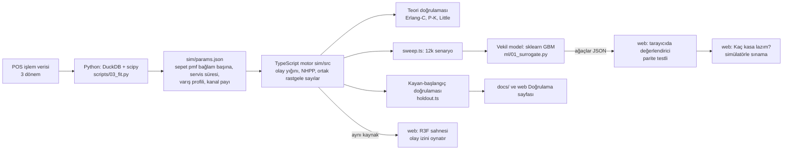

# market-queue-lab

Süpermarket kasa kuyruğu simülatörü: gerçek POS verisinden (Antczak & Weron 2019, CC BY-NC) öğrenilmiş müşteri, sepet ve servis süresi modeli,
ayrık-olay simülasyon motoru, teoriye karşı ve zaman-dışı veriye karşı doğrulama.



Neden bu yığın: veri hazırlama ve istatistiksel uydurma Python'da (DuckDB, scipy) kısa; simülasyon motoru ise web katmanında (R3F) aynen çalışacağı için
TypeScript'te, parametreler zod ile çalışma anında doğrulanan bir JSON dosyasıyla taşınıyor. Backend gerekmiyor.

```bash
python -m venv .venv && .venv/bin/pip install -r requirements.txt
(cd sim && npm install && npm test) && (cd web && npm install && npm run dev)
```

## Web arayüzü (`web/`)

- **Laboratuvar:** Gerçek yürüme hızıyla çalışan 3D mağaza. Üç kuyruk düzeni (ayrı/en kısayı seçer, ayrı/rastgele seçer, tek ortak kıvrımlı kuyruk) yan yana, aynı müşteri akışıyla. Altında 30 tekrarlı eşleştirilmiş karşılaştırma ve kuyruk uzunluğu grafiği.
- **Kaç kasa lazım?:** Tarayıcıda çalışan vekil modelle saat saat kasa planı; her satır gerçek simülatörle sınanabilir.
- **Doğrulama:** Teoriye ve görülmemiş döneme karşı sonuçlar, kayma, kalibrasyon ve sınırlar.

Motor `sim/src`'ten kopyalanmadan içe aktarılır; sahne motorun ürettiği olay izini oynatır, ayrı bir animasyon verisi yoktur.
Vekil model Python'da eğitilir (`ml/`), ağaçları `ml/05_export_web.py` ile JSON'a dökülür ve web testi tarayıcı değerlendiricisini scikit-learn tahminleriyle karşılaştırır.

ML katmanı (vekil model, personel planı, varış tahmini): [docs/ML.md](docs/ML.md).

Veri ve indirme: `data/README.md`. Doğrulamanın tamamı ve sınırlamalar: [docs/VALIDATION.md](docs/VALIDATION.md).
