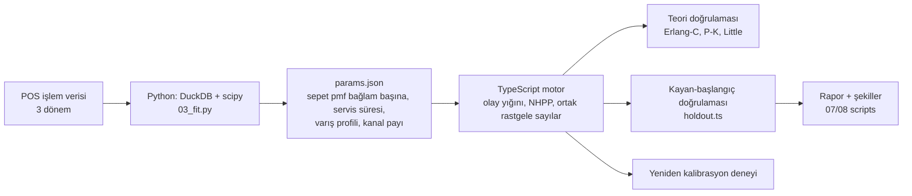

# market-queue-lab

Süpermarket kasa kuyruğu simülatörü: gerçek POS verisinden (Antczak & Weron 2019, CC BY-NC) öğrenilmiş müşteri, sepet ve servis süresi modeli,
ayrık-olay simülasyon motoru, teoriye karşı ve zaman-dışı veriye karşı doğrulama.



Neden bu yığın: veri hazırlama ve istatistiksel uydurma Python'da (DuckDB, scipy) kısa; simülasyon motoru ise web katmanında (R3F) aynen çalışacağı için
TypeScript'te, parametreler zod ile çalışma anında doğrulanan bir JSON dosyasıyla taşınıyor. Backend gerekmiyor.

```bash
python -m venv .venv && .venv/bin/pip install -r requirements.txt
cd sim && npm install && npx vitest run
```

Veri ve indirme: `data/README.md`. Doğrulamanın tamamı ve sınırlamalar: [docs/VALIDATION.md](docs/VALIDATION.md).
