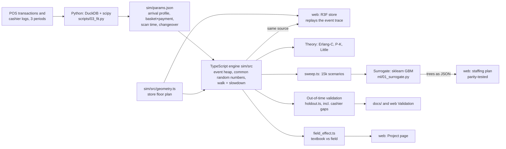

# market-queue-lab

One shared line, or a line for every checkout? A discrete-event simulation of supermarket checkouts, learned from real point-of-sale records
(Antczak & Weron 2019, 163k transactions, CC BY-NC), validated against queueing theory and against a period the model never saw, and replayed in the
browser as a 3D store. The site is in English and Turkish.

**Finding.** In the textbook model (M/G/c) a shared line wins at every load. The data adds two things: every customer comes with a ~16 s cashier
changeover, and the store runs its lanes at ~93% occupancy. Add two costs of a shared line, the walk to the freed lane (from the 3D scene geometry)
and a 6.86% cashier slowdown (Wang & Zhou 2018), and separate lines wait less once occupancy passes ~65%. Above 80% the walk alone is enough.
The slowdown is borrowed from another store, so the site also shows the break-even slowdown at every load.



**Why this stack.** Data preparation and fitting are short in Python (DuckDB, scipy). The engine is TypeScript because the web layer runs it unchanged,
with parameters carried in a JSON file validated by zod at runtime. Everything runs client-side, so there is no backend and the build can be dropped into
any static host, including a subfolder (`base: './'`, hash routing).

```bash
python -m venv .venv && .venv/bin/pip install -r requirements.txt
(cd sim && npm install && npm test) && (cd web && npm install && npm test && npm run dev)
```

To regenerate every number from the raw data (download instructions in `data/README.md`):

```bash
.venv/bin/python scripts/01_load.py && scripts/pipeline.sh
```

## Web (`web/`)

| Page | What it does |
|---|---|
| Project `#/` | Problem, approach, findings and limits: a “barcode” of every customer’s wait under both layouts, textbook vs field model, break-even slowdown |
| Lab `#/lab` | 3D store replaying the event trace at real walking speed; three layouts side by side with a 30-replication paired comparison |
| How many lanes? `#/kasa` | Hour-by-hour staffing plan from the surrogate, compared with what the store actually opened; every row can be checked in the simulator |
| Validation `#/dogrulama` | Theory, out-of-time validation, cashier gaps, recalibration, ML evaluation, limits |
| Method `#/yontem` | Every formula in the model (KaTeX) and references |

The scene has no separate animation data: it replays the engine trace (`called → start → scanEnd → end`). The walking seconds charged to a shared
line are computed from the distances drawn in the scene (`sim/src/geometry.ts`, `sim/src/field.ts`). Copy lives in `web/src/i18n/ui.ts` and
`web/src/content/`, typed so both languages must cover the same keys.

## Tests

`sim`: 55 tests (engine vs theory, invariants, changeover/walk/slowdown mechanics, leakage guard).
`web`: 77 tests (surrogate parity with Python, staffing plan identical to the Python plan, replay, geometry, formatting in both languages).
CI runs lint, type checks, tests and the build on every push.

## Docs (Turkish)

- [docs/VALIDATION.md](docs/VALIDATION.md): what we know and what we don’t
- [docs/ML.md](docs/ML.md): surrogate, staffing plan, arrival forecast
- [docs/HANDOFF.md](docs/HANDOFF.md): architecture rules and open gaps

## Türkçe özet

Süpermarkette tek ortak kuyruk mu, her kasaya ayrı kuyruk mu? Gerçek kasa kayıtlarından öğrenilmiş bir ayrık olay simülasyonu. Ders kitabı modelinde
ortak kuyruk hep kazanıyor. Kasiyerin müşteri arası geçiş süresi, ortak kuyrukta kasaya yürüme ve kasiyer yavaşlaması eklenince, doluluk ~%65'i
geçtiğinde ayrı kuyruklar daha az bekletiyor. Site Türkçe ve İngilizce; ayrıntılı belgeler `docs/` altında Türkçe.
